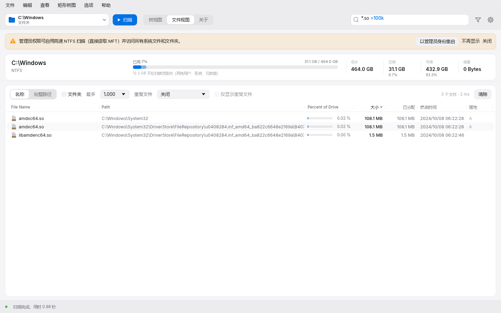

# MosaicDisk

一款用 Rust 编写的快速磁盘空间分析器，支持 Windows、Linux 和 macOS。
参照 [WizTree](https://diskanalyzer.com) 设计：一次快速扫描，随后树视图、软垫矩形树图和可搜索文件列表都能即时响应。


磁盘只被并行扫描一次，结果存入紧凑的内存索引。树视图、矩形树图、文件列表、搜索、过滤和重复文件查找都基于这个索引工作，不会再访问磁盘。

## 为什么在 NTFS 上这么快

在 NTFS 分区上（Windows，以及 Linux 的 `ntfs3`/`ntfs-3g` 挂载），MosaicDisk 直接读取主文件表（MFT）——与 WizTree 采用同样的方法——而不是逐层遍历目录。这只是一次基本顺序的读取，并通过 `$MFT:$BITMAP` 跳过 MFT 中的空闲部分。

| 70 万条目的 NTFS USB 硬盘，冷缓存 | 耗时 |
|---|---|
| 目录遍历 | 262 秒 |
| MFT 读取 | 17 秒（受磁盘速度限制） |
| 再次扫描，热缓存 | 0.3–1 秒 |

在 Linux 上读取裸设备需要 root 权限。MosaicDisk 每个会话只请求一次密码，并通过一个小助手程序只传输 MFT 内容（`mosaicdisk --mft-dump DEV`）。它还可以安装 udev 规则，让登录用户访问 NTFS 分区（`uaccess`），之后就不再需要提示。当你在机械 NTFS 硬盘上扫描某个文件夹时，MosaicDisk 会先遍历最多 2 秒，如果发现目录很大就切换到 MFT 方式。

无头 CSV 导出已与 WizTree 4.33 对同一驱动器的 MFT 扫描逐行核对（700,604 行）。大小、分配大小（含备用数据流）、修改日期和属性值全部一致。

## 功能

- **树视图**：占父级百分比、大小、已分配大小、文件/文件夹计数、日期与属性、「[N 个文件位于 …]」分组，以及文件类型面板
- **矩形树图**：软垫着色（WizTree 同款）、缩放、悬停、标签、可用空间、PNG 导出
- **文件视图**：用 WizTree 语法搜索全部文件（通配符、`|` 或、`!` 非、`>1gb`、日期、`=folder`、`namelen>`、`\regex\`、`dupcount>`），并支持重复文件检测
- **过滤与导出**：扫描结果过滤、CSV/TSV 导出与导入（WizTree 兼容）、文件类型导出
- **实时更新**：文件系统监视让结果保持最新；可在应用内删除、移入回收站、重命名、复制、打开、在文件管理器中显示、打开终端
- **主题**：九套主题加自动、11 种强调色、十种矩形树图配色和自定义调色板
- **多语言**：内置简体中文（默认跟随配置），也可在 exe 旁放置 `locale/<lang>/LC_MESSAGES/default.po` 添加语言



## 安装

需要较新的 Rust stable 工具链（edition 2024，即 Rust 1.85+）。

```sh
git clone https://github.com/zeno-ling/mosaicdisk
cd mosaicdisk
cargo build --release
./target/release/mosaicdisk [PATH...]
```

或直接安装到 `~/.cargo/bin`：

```sh
cargo install --git https://github.com/zeno-ling/mosaicdisk
```

`mimalloc` 是默认特性；用 `--no-default-features` 可改用系统分配器。

设置保存在平台的配置目录。想要便携版，在 exe 旁放一个空的 `mosaicdisk.json` 即可生效。

## 命令行

WizTree 风格的选项可用于无头导出，例如：

```sh
mosaicdisk C:\ /export=disk.csv /exportfolders=0 /filter="*.mp4|*.mkv"
mosaicdisk /home /treemapimagefile=home.png /treemapimagewidth=3840 /treemapimageheight=2160
```

运行 `mosaicdisk --help` 查看完整列表；`--name=value` 写法同样可用。

## 开发

```sh
cargo test --release
# 将所有界面的离屏截图输出到 target/snapshots：
WT_SNAP_PATH=/usr cargo test --release snapshots -- --ignored
# 搜索 / 矩形树图 / 过滤 / 重复文件检测的耗时：
WT_SNAP_PATH=$HOME cargo test --release bench_views -- --ignored --nocapture
```

## 一键打包发布（Windows）

安装 [GitHub CLI](https://cli.github.com/) 并登录（`gh auth login`）后，在项目根目录运行：

```powershell
.\scripts\release.ps1
```

脚本会依次完成：编译 release 二进制 → 复制中文语言包与文档 → 生成 `MosaicDisk-<版本>-windows-x64.zip` → 创建或更新 GitHub Release 并上传资产（同名资产自动覆盖）。可用参数：

```powershell
.\scripts\release.ps1 -Version v0.1.0 -SkipBuild   # 跳过编译，用现有二进制重新打包
.\scripts\release.ps1 -NoUpload                    # 只打包，不推送到 GitHub
```

版本号默认从 `Cargo.toml` 读取。

Linux / macOS 用对应的 shell 脚本，产物为 `MosaicDisk-<版本>-<系统>-<架构>.tar.gz`：

```sh
./scripts/release.sh              # 编译、打包并发布
./scripts/release.sh -s -n        # 跳过编译，只打包不上传
```

## 许可证

[MIT](LICENSE)。随附的 Inter 字体遵循 SIL Open Font License，详见 [`assets/fonts/Inter-LICENSE.txt`](assets/fonts/Inter-LICENSE.txt)。

MosaicDisk 是独立项目，与 WizTree 或 Antibody Software 无关联，也未获其背书。"WizTree" 仅用于描述兼容性。

基于 Divyansh Chandhok 的 [DiskMosaic](https://github.com/divyanshchandhok/diskmosaic)（MIT）构建。
