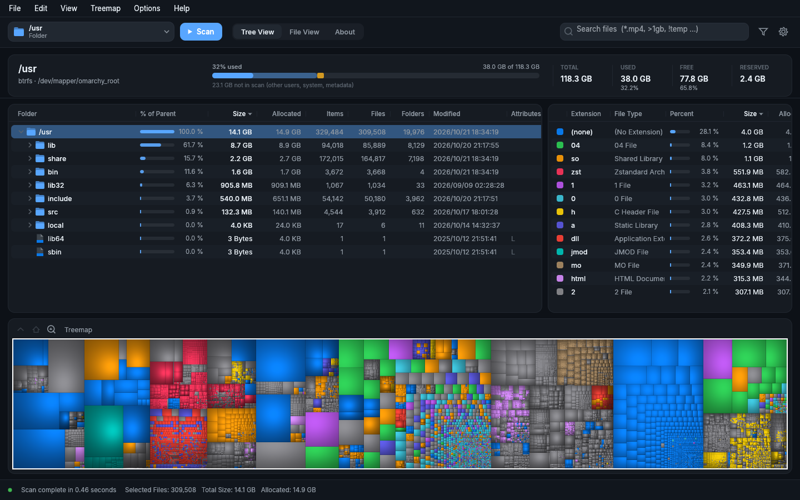

# MosaicDisk

A fast disk space analyser for Windows, Linux and macOS, written in Rust.
Modelled on [WizTree](https://diskanalyzer.com): one quick scan, then a
tree view, a cushion treemap and a searchable file list that all respond
instantly.



The disk is scanned once, in parallel, into a compact in-memory index. The
tree view, treemap, file list, search, filters and duplicate finder all work
from that index and never touch the disk again.

## Why it's fast on NTFS

On NTFS drives (Windows, and Linux `ntfs3`/`ntfs-3g` mounts) MosaicDisk
reads the Master File Table directly — the same technique WizTree uses —
instead of walking folders. That's one mostly sequential read, and it skips
the free parts of the MFT using `$MFT:$BITMAP`.

| 700k-entry NTFS USB hard disk, cold cache | time |
|---|---|
| Folder walk | 262 s |
| MFT read | 17 s (disk-bound) |
| Rescan, warm cache | 0.3–1 s |

On Linux, reading the raw device needs root. MosaicDisk asks for your
password once per session and streams only the MFT through a small helper
(`mosaicdisk --mft-dump DEV`). It can also install a udev rule that gives
the logged-in user access to NTFS partitions (`uaccess`), after which no
prompt is needed. When you scan a folder on a spinning NTFS disk, MosaicDisk
walks it for up to 2 seconds and switches to the MFT if it turns out to be
big.

The headless CSV export was checked row for row against WizTree 4.33's own
MFT scan of the same drive (700,604 rows). Sizes, allocated sizes (including
alternate data streams), modification dates and attribute values all match.

## 功能

- **树视图**：占父级百分比、大小、已分配大小、文件/文件夹计数、日期与属性、「[N 个文件位于 …]」分组，以及文件类型面板
- **矩形树图**：软垫着色（WizTree 同款）、缩放、悬停、标签、可用空间、PNG 导出
- **文件视图**：用 WizTree 语法搜索全部文件（通配符、`|` 或、`!` 非、`>1gb`、日期、`=folder`、`namelen>`、`\regex\`、`dupcount>`），并支持重复文件检测
- **过滤与导出**：扫描结果过滤、CSV/TSV 导出与导入（WizTree 兼容）、文件类型导出
- **实时更新**：文件系统监视让结果保持最新；可在应用内删除、移入回收站、重命名、复制、打开、在文件管理器中显示、打开终端
- **主题**：九套主题加自动、11 种强调色、十种矩形树图配色和自定义调色板
- **多语言**：内置简体中文（默认跟随配置），也可在 exe 旁放置 `locale/<lang>/LC_MESSAGES/default.po` 添加语言


## 安装

需要较新的 Rust stable 工具链（edition 2024，即 Rust 1.85+）。

```sh
git clone https://github.com/zeno-ling/mosaicdisk
cd mosaicdisk
cargo build --release
./target/release/mosaicdisk [PATH...]
```

或直接安装到 `~/.cargo/bin`：

```sh
cargo install --git https://github.com/zeno-ling/mosaicdisk
```

`mimalloc` 是默认特性；用 `--no-default-features` 可改用系统分配器。

设置保存在平台的配置目录。想要便携版，在 exe 旁放一个空的
`mosaicdisk.json` 即可生效。

## 命令行

WizTree 风格的选项可用于无头导出，例如：

```sh
mosaicdisk C:\ /export=disk.csv /exportfolders=0 /filter="*.mp4|*.mkv"
mosaicdisk /home /treemapimagefile=home.png /treemapimagewidth=3840 /treemapimageheight=2160
```

运行 `mosaicdisk --help` 查看完整列表；`--name=value` 写法同样可用。

## Development

```sh
cargo test --release
# Offscreen screenshots of every screen into target/snapshots:
WT_SNAP_PATH=/usr cargo test --release snapshots -- --ignored
# Timing of search / treemap / filter / duplicates:
WT_SNAP_PATH=$HOME cargo test --release bench_views -- --ignored --nocapture
```

## License

[MIT](LICENSE). The bundled Inter font is under the SIL Open Font License;
see [`assets/fonts/Inter-LICENSE.txt`](assets/fonts/Inter-LICENSE.txt).

MosaicDisk is an independent project and isn't affiliated with or endorsed
by WizTree or Antibody Software. "WizTree" is used only to describe
compatibility.

Based on [DiskMosaic](https://github.com/divyanshchandhok/diskmosaic) by
Divyansh Chandhok (MIT).
